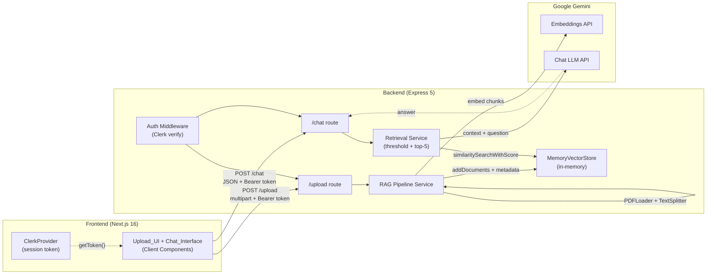

# Design Document

## Overview

This document describes the architecture and detailed design for the PDF RAG (Retrieval-Augmented Generation) System. It covers the system architecture, frontend and backend components, data flows for upload and chat, the REST API contract, data models, technology choices, file structure, configuration, error handling, and correctness properties that the implementation must satisfy.

The system is a two-tier application: a Next.js 16 frontend (Client Components) and an Express 5 backend that runs a LangChain RAG pipeline powered by Google Gemini. Clerk authentication is already configured on the frontend and is extended to the backend so that only authenticated users can upload documents or ask questions.

## Architecture

The system has three runtime layers:

1. **Frontend (Next.js 16)** — A client-heavy interactive single-page experience. The shell is Server-Components-rendered for fast first paint, but the Upload and Chat interactions live in Client Components that call the backend directly over HTTP. Clerk already wraps the app in `layout.tsx` and gates the UI behind a sign-in screen.
2. **Backend (Express 5 + TypeScript)** — A stateful API server that owns the RAG pipeline: PDF loading, chunking, embedding, in-memory vector storage, similarity retrieval, and LLM answer generation. It verifies Clerk session tokens on every protected route.
3. **LLM / Embedding Provider (Google Gemini)** — Accessed server-side only via `@langchain/google-genai`. The frontend never sees the Gemini API key.

The vector store is an in-memory `MemoryVectorStore` (cosine similarity). This is intentionally ephemeral and process-scoped, matching the "conversation session resets on reload" model and keeping the project free of external database dependencies. Chunk metadata (document id, source filename, page, chunk index, owning user) is stored alongside each embedding so retrieval can return source references and scope results per user.



## Components and Interfaces

### Frontend Components

The frontend is organized around feature components in `client/components` with shadcn UI primitives in `client/components/ui`. Interactive components use the `"use client"` directive; the page shell stays a Server Component.

- **`app/page.tsx`** (Server Component) — Renders the static shell and mounts the client container. With `cacheComponents` enabled, this page reads no request data directly, so it prerenders cleanly.
- **`components/pdf-rag-app.tsx`** (`"use client"`) — Top-level client container that composes the upload and chat panels and owns shared layout state (e.g., which document was just uploaded).
- **`components/upload-panel.tsx`** (`"use client"`) — The **Upload_UI**. Provides a file input and a drag-and-drop dropzone, performs client-side validation (PDF MIME type, max 10 MB), shows success/error messages, and uploads the file. It obtains the Clerk session token via `useAuth().getToken()` and attaches it as an `Authorization: Bearer <token>` header.
- **`components/chat-panel.tsx`** (`"use client"`) — The **Chat_Interface**. Owns the in-memory conversation history (`useState`), renders the message list, a 1000-character input field, and a loading indicator shown while a request is in flight. Validates the question before sending.
- **`components/chat-message.tsx`** — Renders a single conversation turn (user or assistant) including any source references returned by the backend.
- **`components/ui/*`** — shadcn primitives (button, input, card, scroll-area, alert, etc.) used by the panels.
- **`lib/api.ts`** — Thin API client: `uploadPdf(file, token)` and `askQuestion(question, token)`. Both target `NEXT_PUBLIC_API_URL` and forward the Bearer token.
- **`lib/validation.ts`** — Pure validation helpers `validatePdfFile(file)` and `validateQuestion(question)` used by the panels before any network call.

### Backend Components

The backend separates HTTP routing from the RAG domain logic. Services are singletons created at process start so the in-memory vector store persists across requests within the process.

- **`src/config/env.ts`** — Loads and validates required environment variables at startup; fails fast if `GOOGLE_API_KEY` or Clerk keys are missing.
- **`src/middleware/auth.middleware.ts`** — Mounts Clerk's `clerkMiddleware` (from `@clerk/express`) and exports a `requireAuth` guard that returns `401` when `req.auth?.userId` is absent. Clerk's middleware reads the session JWT from both cookies and the `Authorization` header, so cross-origin Bearer-token requests are verified.
- **`src/middleware/error.middleware.ts`** — Centralized error handler. Maps known domain errors to `400` and everything else to a `500` with a generic message that never exposes stack traces, file paths, or internal details.
- **`src/middleware/multer.middleware.ts`** — Existing multer config (PDF-only filter, 10 MB limit). Kept as-is.
- **`src/services/embeddings.service.ts`** — Singleton `GoogleGenerativeAIEmbeddings` (Gemini embedding model).
- **`src/services/llm.service.ts`** — Singleton `ChatGoogleGenerativeAI` (Gemini chat model).
- **`src/services/vector-store.service.ts`** — Owns a singleton `MemoryVectorStore` and an in-memory `DocumentRegistry`. Exposes `addDocuments(chunks, metadata)`, `search(question, { userId, k, threshold })` (returns scored docs scoped to the user), and registry helpers.
- **`src/services/pdf.service.ts`** — `loadAndSplit(filePath, source)`: uses LangChain `PDFLoader` to extract text, then `RecursiveCharacterTextSplitter` to chunk. Throws a domain `ExtractionError` when extraction fails or the text is empty.
- **`src/services/retrieval.service.ts`** — `retrieve(question, userId)`: runs `similaritySearchWithScore` with a per-user filter, applies the `0.3` similarity threshold, and returns at most 5 chunks (or `null` when none qualify).
- **`src/services/rag.service.ts`** — Orchestration. `processUpload(file, userId)` runs the full pipeline and returns a document id; `answerQuestion(question, userId)` retrieves chunks, builds the RAG prompt, calls the Gemini LLM, and returns the answer plus source references (or a no-information response).
- **`src/routes/*.routes.ts`** — Route definitions for `/health`, `/upload`, and `/chat`, each applying `requireAuth` where appropriate.
- **`src/types/index.ts`** — Shared request/response and metadata interfaces.
- **`src/types/globals.d.ts`** — Optional global typing so `req.auth` is typed on Express requests.

## Data Flow

### Upload Flow

1. A signed-in user selects (or drops) a PDF in `upload-panel.tsx`.
2. The panel runs `validatePdfFile(file)`; if the file is not PDF or exceeds 10 MB, it shows a client error and never calls the network.
3. The panel calls `useAuth().getToken()` to get a fresh Clerk session JWT.
4. `uploadPdf(file, token)` issues `POST {API_URL}/upload` with `multipart/form-data` (field name `pdf`) and `Authorization: Bearer <token>`.
5. Backend: `clerkMiddleware` verifies the token; `requireAuth` rejects unauthenticated callers with `401`. Multer saves the file and enforces PDF-only/10 MB again.
6. `rag.service.processUpload(savedPath, userId)`:
   - `pdf.service.loadAndSplit` extracts and chunks text. Empty/failed extraction throws `ExtractionError` → `400 "PDF is not processable"`.
   - Embeddings are generated for every chunk. On embedding failure, an error is returned and **no** documents are added to the store.
   - Chunks are added to the `MemoryVectorStore` with metadata `{ documentId, source, page, chunkIndex, userId }`, and the `DocumentRegistry` records the document.
7. Backend returns `200` with `{ message, documentId, source, chunkCount }`.
8. The panel shows a success confirmation, or an error message describing the failure reason.

### Chat Flow

1. The user types a question (max 1000 chars) in `chat-panel.tsx`; the field is capped and validated by `validateQuestion`.
2. On submit, if the trimmed question is empty or exceeds 1000 characters, a validation error is shown and **no** request is sent.
3. The panel appends the user's question to in-memory history, shows a loading indicator, and calls `askQuestion(question, token)`.
4. Backend: `clerkMiddleware` + `requireAuth` enforce auth; unauthenticated callers get `401`.
5. `rag.service.answerQuestion(question, userId)`:
   - `retrieval.service.retrieve` searches the store scoped to `userId`, filters by similarity `>= 0.3`, and takes at most 5 chunks.
   - If no chunk qualifies, the backend returns a no-information response `{ answer: null, message, sources: [] }`.
   - Otherwise the retrieved chunks and the question are passed to the Gemini LLM via a RAG prompt. On LLM failure, an answer-generation error is returned.
   - The backend returns `{ answer, sources: [...] }` with one source reference per retrieved chunk.
6. The panel hides the loading indicator, displays the answer (with source references), and appends it to history. On a network failure, a connection error is shown and the user's input is preserved.

## API Design

Base URL is configurable via `NEXT_PUBLIC_API_URL` (e.g., `http://localhost:8000`). All protected endpoints require `Authorization: Bearer <clerk-session-token>`.

### `GET /health`

Unauthenticated liveness check.

- **Response 200:** `{ "status": "Server is healthy" }`

### `POST /upload`

Uploads and indexes a PDF. Protected.

- **Headers:** `Authorization: Bearer <token>`
- **Body:** `multipart/form-data` with field `pdf`
- **Response 200:**
  ```json
  {
    "message": "File uploaded and processed successfully",
    "documentId": "doc_1700000000000_a1b2c3",
    "source": "report.pdf",
    "chunkCount": 42
  }
  ```
- **Errors:**
  - `401` `{ "error": "unauthenticated", "message": "Authentication required" }`
  - `400` `{ "error": "invalid_file", "message": "Only PDF files are accepted" }` (non-PDF / too large / not processable)
  - `500` `{ "error": "internal", "message": "An unexpected server error occurred" }` (embedding/storage/LLM-auth failure)

### `POST /chat`

Asks a question over previously uploaded documents. Protected.

- **Headers:** `Authorization: Bearer <token>`, `Content-Type: application/json`
- **Body:** `{ "question": "What is the summary of section 2?" }`
- **Response 200 (answer found):**
  ```json
  {
    "answer": "Section 2 describes ...",
    "sources": [
      {
        "documentId": "doc_..._a1b2c3",
        "source": "report.pdf",
        "page": 3,
        "chunkIndex": 0
      }
    ]
  }
  ```
- **Response 200 (no relevant chunks):**
  ```json
  {
    "answer": null,
    "message": "No information was found for your question.",
    "sources": []
  }
  ```
- **Errors:**
  - `401` `{ "error": "unauthenticated", "message": "Authentication required" }`
  - `400` `{ "error": "invalid_question", "message": "Question must be non-empty and at most 1000 characters" }`
  - `500` `{ "error": "internal", "message": "An unexpected server error occurred" }` (answer-generation/LLM-auth failure)

### Error envelope

All error responses share the shape `{ "error": "<machine_code>", "message": "<human_message>" }`. 500-level responses use a fixed generic `message` and never echo stack traces, file paths, or internal identifiers.

## Data Models

### Backend types (`src/types/index.ts`)

```ts
// Metadata attached to every chunk stored in the vector store.
interface ChunkMetadata {
  documentId: string;
  source: string; // original filename
  page: number;
  chunkIndex: number;
  userId: string; // owning Clerk user id; used for per-user scoping
}

// One source reference returned with an answer.
interface SourceReference {
  documentId: string;
  source: string;
  page: number;
  chunkIndex: number;
}

interface UploadSuccessResponse {
  message: string;
  documentId: string;
  source: string;
  chunkCount: number;
}

interface ChatAnswerResponse {
  answer: string;
  sources: SourceReference[];
}

interface ChatNoInfoResponse {
  answer: null;
  message: string;
  sources: SourceReference[];
}

interface ErrorResponse {
  error: string;
  message: string;
}
```

### Frontend types (`client/lib/types.ts`)

```ts
type ChatRole = "user" | "assistant";

interface ChatMessage {
  id: string;
  role: ChatRole;
  content: string;
  sources?: SourceReference[]; // present on assistant messages that had references
  timestamp: number;
}
```

### In-memory document registry

```ts
interface DocumentRecord {
  documentId: string;
  source: string;
  pagecount: number;
  chunkCount: number;
  userId: string;
  createdAt: number;
}
// Held in a Map<string, DocumentRecord> alongside the vector store.
```

## Technology Choices

| Concern             | Choice                                                                                                                       | Rationale                                                                                                                                                                                                               |
| ------------------- | ---------------------------------------------------------------------------------------------------------------------------- | ----------------------------------------------------------------------------------------------------------------------------------------------------------------------------------------------------------------------- |
| PDF text extraction | `PDFLoader` from `@langchain/community/document_loaders/fs/pdf` (uses `pdf-parse`)                                           | LangChain-native loader that returns page-aware `Document[]`, matching the source-reference requirement.                                                                                                                |
| Text splitting      | `RecursiveCharacterTextSplitter` from `langchain/text_splitter`                                                              | Standard LangChain splitter that keeps semantic boundaries; config `chunkSize`/`chunkOverlap` are project-controlled.                                                                                                   |
| Embeddings          | `GoogleGenerativeAIEmbeddings` from `@langchain/google-genai`                                                                | User-selected Gemini embeddings; server-side only.                                                                                                                                                                      |
| LLM                 | `ChatGoogleGenerativeAI` from `@langchain/google-genai`                                                                      | User-selected Gemini chat model for grounded answers.                                                                                                                                                                   |
| Vector store        | `MemoryVectorStore` from `langchain/vectorstores/memory`                                                                     | In-memory, no external DB, cosine similarity, supports `similaritySearchWithScore` with a filter predicate. Ideal for a small project. Note: it does not support ids/deletion, so the store is append-only per process. |
| Retrieval           | Custom retrieval service over `similaritySearchWithScore` (threshold + top-5 + user filter) feeding the LLM via a RAG prompt | Gives explicit control over the 0.3 threshold, the 5-chunk limit, per-user scoping, and source-reference extraction that a black-box `RetrievalQAChain` would hide.                                                     |
| Backend framework   | Express 5 (already in place) + `cors`                                                                                        | Existing setup; CORS is needed because the frontend is a separate origin.                                                                                                                                               |
| Backend auth        | `@clerk/express` (`clerkMiddleware` + `requireAuth`)                                                                         | Verifies the same Clerk session tokens the frontend already issues; reads cookies and `Authorization` headers so cross-origin Bearer-token auth works.                                                                  |
| Frontend auth token | `useAuth().getToken()` from `@clerk/nextjs`                                                                                  | Produces a short-lived session JWT to send cross-origin as a Bearer token.                                                                                                                                              |
| Frontend styling/UI | Tailwind CSS 4 + shadcn (already configured)                                                                                 | Existing project convention.                                                                                                                                                                                            |
| State management    | React `useState` for chat history                                                                                            | History is per-session and resets on reload (no persistence needed).                                                                                                                                                    |

### Similarity score semantics

`MemoryVectorStore` uses cosine similarity by default; higher is more similar. For normalized Gemini embeddings, scores fall roughly in `[0, 1]`, so a threshold of `0.3` selects chunks that are at least somewhat related to the question while filtering noise.

### Retrievability note on `MemoryVectorStore`

Because `MemoryVectorStore` exposes neither ids nor deletion, the store is append-only for the life of the process. Per-user isolation is achieved by tagging every chunk with `userId` and filtering on retrieval rather than by maintaining separate stores. This is an accepted trade-off for a small/demo project; a persistent store (e.g., Chroma) would be the upgrade path.

## File Structure

### Frontend (`client/`)

```
client/
  app/
    layout.tsx            # existing ClerkProvider + header (unchanged)
    page.tsx              # Server Component shell -> mounts <PdfRagApp />
    globals.css           # existing Tailwind setup
  components/
    pdf-rag-app.tsx       # client container (upload + chat)
    upload-panel.tsx      # Upload_UI (use client)
    chat-panel.tsx        # Chat_Interface (use client)
    chat-message.tsx      # single message renderer
    ui/                   # shadcn primitives (button, input, card, scroll-area, alert, ...)
  lib/
    api.ts               # uploadPdf, askQuestion
    validation.ts        # validatePdfFile, validateQuestion
    types.ts             # ChatMessage, SourceReference
    utils.ts             # existing cn helper
  .env                   # NEXT_PUBLIC_API_URL + existing Clerk keys
```

### Backend (`server/`)

```
server/
  src/
    app.ts               # express app: cors, clerkMiddleware, routes, error handler
    server.ts            # starts the HTTP server (existing)
    config/
      env.ts             # env loading + validation
    middleware/
      auth.middleware.ts  # clerkMiddleware + requireAuth
      error.middleware.ts# centralized error handler (no internal leaks)
      multer.middleware.ts# existing PDF/10MB config
    routes/
      health.routes.ts
      upload.routes.ts
      chat.routes.ts
    services/
      embeddings.service.ts
      llm.service.ts
      vector-store.service.ts
      pdf.service.ts
      retrieval.service.ts
      rag.service.ts
    types/
      index.ts           # shared interfaces
      globals.d.ts       # Clerk req.auth typing (optional)
  .env                   # GOOGLE_API_KEY, CLERK_*, CLIENT_URL, PORT
```

## Configuration and Environment Variables

### Backend (`server/.env`)

```env
# Google Gemini
GOOGLE_API_KEY=your_gemini_api_key

# Clerk (backend verification of session tokens)
CLERK_PUBLISHABLE_KEY=your_clerk_publishable_key
CLERK_SECRET_KEY=your_clerk_secret_key

# Server
PORT=8000
CLIENT_URL=http://localhost:3000   # CORS origin for the Next.js frontend
```

- `GOOGLE_API_KEY` is passed to the LangChain Gemini clients (embeddings + LLM). If missing/invalid, requests that need embeddings or answers return an LLM-authentication error and do not proceed.
- `CLERK_SECRET_KEY` / `CLERK_PUBLISHABLE_KEY` let `@clerk/express` verify session JWTs issued by the frontend.
- `CLIENT_URL` configures `cors({ origin, credentials: true })`.
- The dev script runs with env loaded, e.g. `tsx watch --env-file=.env src/server.ts` (or a `dotenv` import), so keys are available at import time.

### Frontend (`client/.env`)

```env
# Existing Clerk keys already present:
# NEXT_PUBLIC_CLERK_PUBLISHABLE_KEY=...

# Backend API base URL (cross-origin)
NEXT_PUBLIC_API_URL=http://localhost:8000
```

- `NEXT_PUBLIC_API_URL` is read by `lib/api.ts`. Because it is `NEXT_PUBLIC_`-prefixed it is safely exposed to the client bundle; the Gemini key is never exposed to the frontend.

### Cross-origin auth

Because the frontend and backend are different origins, cookies alone cannot carry the Clerk session. The frontend therefore fetches a short-lived session JWT with `useAuth().getToken()` and sends it as `Authorization: Bearer <token>`. The backend's `clerkMiddleware` verifies it from that header.

## Error Handling

The design follows a "fail loudly, leak nothing" policy.

- **Domain errors to HTTP mapping** (`error.middleware.ts`):
  - `ExtractionError` (empty/unreadable PDF) → `400` `invalid_file` / "PDF is not processable".
  - `EmbeddingError` / `StorageError` / `LLMError` → `500` generic message; the orchestration guarantees no partial store writes on embedding failure.
  - `AuthError` (missing/invalid Gemini key) → `500` with an "LLM provider authentication failed" message; the operation does not proceed.
  - Unknown errors → `500` generic message.
- **No internal leakage**: 500 responses always return the fixed generic `message` and never include stack traces, file paths, DB info, or raw error text. The backend logs full errors server-side only.
- **Frontend behavior**:
  - Validation failures (PDF type/size, question length) are handled before any request; the input/state is preserved.
  - Network failures between frontend and backend show a connection error and **preserve** the user's entered question.
  - 500-level responses show a generic user-facing message; the raw backend error `message` for 500s is treated as untrusted and not rendered verbatim.
- **Partial-failure safety**: embedding failure during upload is treated as a transaction boundary — if embeddings fail, no chunks are added to the vector store, so the store never contains half-indexed documents.

## Correctness Properties

_A property is a characteristic or behavior that should hold true across all valid executions of a system — essentially, a formal statement about what the system should do. Properties serve as the bridge between human-readable specifications and machine-verifiable correctness guarantees._

The property tests below target our own pure logic and orchestration (validation, filtering, metadata, error containment) and use mock embeddings/LLM/store where external services are involved, per the project's testing strategy. External-service behaviors (real Gemini calls, real PDF parsing) are covered by a small number of integration/smoke tests, not enumerated here.

### Property 1: PDF file validation gate

_For any_ file a user could select, the upload UI SHALL accept it if and only if its MIME type is `application/pdf` and its byte size is less than or equal to 10 megabytes; every rejected file SHALL prevent the upload request from being sent.

**Validates: Requirements 1.2, 1.3, 1.6**

### Property 2: Question validation gate

_For any_ string submitted in the chat input, the frontend SHALL send it to the backend if and only if it is non-empty after trimming and its length is at most 1000 characters; every string failing this rule SHALL be rejected with a validation error and SHALL NOT be sent. (The input field is capped at 1000 characters so longer input cannot be entered.)

**Validates: Requirements 3.1, 3.2**

### Property 3: Chunking invariants

_For any_ non-empty extracted text, the text splitter SHALL produce at least one non-empty chunk whose length does not exceed the configured `chunkSize`, and the union of the chunk contents SHALL cover the original text. _For any_ empty/whitespace-only input, no usable chunks SHALL be produced.

**Validates: Requirements 2.2**

### Property 4: Vector store metadata round-trip

_For any_ set of chunks added to the vector store with chunk metadata, a subsequent similarity search SHALL return documents whose metadata is equal to the metadata supplied at insertion time.

**Validates: Requirements 2.4**

### Property 5: Embedding failure leaves the store unchanged

_For any_ upload attempt in which the embeddings step fails, the vector store SHALL contain no new documents afterward and the backend SHALL return an error response rather than a success response.

**Validates: Requirements 2.7, 6.1**

### Property 6: Retrieval threshold and top-k limit

_For any_ set of similarity-scored candidate chunks, the retrieval service SHALL return at most 5 chunks, every returned chunk SHALL have a similarity score at or above 0.3, and the returned chunks SHALL be ordered by descending similarity score.

**Validates: Requirements 4.1**

### Property 7: No relevant chunks yields a no-information response

_For any_ candidate set in which every chunk has a similarity score below 0.3, the backend SHALL return a response with `answer` set to null, a no-information message, and an empty sources array.

**Validates: Requirements 4.4**

### Property 8: Source references match retrieved chunks

_For any_ retrieval that passes N chunks to the LLM, the response SHALL contain exactly N source references, each matching the document id, source filename, page, and chunk index of one of the passed chunks.

**Validates: Requirements 4.5**

### Property 9: Per-user retrieval isolation

_For any_ retrieval performed for a given user, no returned chunk SHALL carry metadata belonging to a different user; chunks uploaded by other users SHALL never appear in that user's answer sources.

**Validates: Requirements 5.2**

### Property 10: Unauthenticated requests rejected

_For any_ request to the `/upload` or `/chat` endpoints that lacks a valid Clerk session token, the backend SHALL return a 401 status code with an authentication error message and SHALL NOT execute the route's core handler.

**Validates: Requirements 5.2**

### Property 11: Error responses never leak internals

_For any_ error that produces a 500-level response, the response body SHALL contain only a generic message and SHALL NOT contain stack traces, file paths, database identifiers, or other internal implementation details.

**Validates: Requirements 6.4**

### Property 12: User input preserved on network error

_For any_ chat submission in which the request to the backend fails due to a network error, the frontend SHALL display a connection-error message and SHALL preserve the user's entered question unchanged in the input field.

**Validates: Requirements 6.2**

### Property 13: Conversation history reflects the session

_For any_ sequence of submitted questions and received answers within a session, the conversation history SHALL contain every submitted question and every received answer in submission order, and the history SHALL not be persisted across page reloads.

**Validates: Requirements 3.5**

## Testing Strategy

- **Property tests (above)**: pure validation, retrieval filtering, metadata, auth gating, error containment, and history logic — each run with at least 100 randomized iterations, using mock embeddings/LLM/store where the real services would otherwise incur cost.
- **Example/unit tests**: specific UI wiring (upload triggers, success/error message display, loading indicator, answer rendering), boundary files (exactly 10 MB; non-PDF MIME), and the API client call shapes.
- **Integration tests (1–3 examples)**: real PDF extraction through `PDFLoader`, real Gemini embedding/LLM calls, and an end-to-end upload-then-chat round trip against a running backend.
- **Smoke tests**: the signed-out layout renders the Clerk sign-in screen and the signed-in layout renders the Upload_UI and Chat_Interface.
