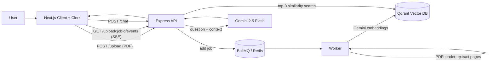

# 📄 PDF-RAG: Chat with your PDFs

PDF-RAG is a full-stack **Retrieval-Augmented Generation (RAG)** application. Sign in, upload a PDF, and ask questions about it. Answers are generated by Google Gemini using only the relevant parts of your document, and each answer comes with the source file and page number.

The assistant also understands **English, Hinglish and Hindi (Devanagari)** and replies in the same language and script you write in.

---

## ✨ Features

- 🔐 **Authentication** with Clerk (sign-in required to use the app)
- 📤 **PDF upload** with drag and drop, PDF-only validation and a 10 MB limit
- ⚙️ **Background processing** with BullMQ + Redis/Valkey, so uploads never block the API
- 📡 **Live progress updates** over Server-Sent Events (`queued → processing → completed / failed`)
- 🔎 **Semantic search** using Gemini embeddings stored in Qdrant
- 🤖 **Grounded answers** from Gemini 2.5 Flash, with a system prompt that blocks made-up facts and ignores instructions hidden inside documents
- 📚 **Source citations** (file name and page number) for every answer
- 🌗 **Light / dark theme** and a responsive UI
- 📝 Markdown rendering for answers (tables, lists, code) via `react-markdown` + `remark-gfm`

---

## 🧠 How it works



**Upload flow**

1. The client sends the PDF to `POST /upload` with the Clerk session token.
2. Multer saves the file temporarily in `server/src/public` and a job is added to the BullMQ queue.
3. The worker loads the PDF page by page (`PDFLoader`), creates embeddings with `gemini-embedding-001` and stores them in the Qdrant collection `pdf-collection`.
4. The client follows progress through `GET /upload/:jobId/events` (SSE). When the stream closes, the temporary PDF is deleted from the server.

**Chat flow**

1. The client sends the question to `POST /chat`.
2. The server retrieves the **top 3** most similar pages from Qdrant.
3. The question and retrieved context go to `gemini-2.5-flash` with a strict RAG system prompt.
4. The answer and the sources (file name, page number) are returned to the UI.

---

## 🛠️ Tech stack

| Layer | Technology |
| --- | --- |
| Frontend | Next.js 16, React 19, TypeScript, Tailwind CSS v4, shadcn/ui, Base UI, lucide-react |
| Auth | Clerk (`@clerk/nextjs`) |
| Backend | Node.js, Express 5, TypeScript (run with `tsx`) |
| Queue | BullMQ + ioredis, Valkey (Redis-compatible) via Docker |
| AI | Google Gemini (`gemini-2.5-flash` for answers, `gemini-embedding-001` for embeddings) |
| RAG tooling | LangChain (`@langchain/community`, `@langchain/google-genai`, `@langchain/qdrant`) |
| Vector DB | Qdrant |
| File handling | Multer, pdf-parse |
| Package manager | pnpm |

---

## 📁 Project structure

```
pdf-rag-application/
├── client/                     # Next.js frontend
│   ├── app/                    # layout (Clerk), page, global styles
│   ├── components/             # upload-panel, chat-panel, chat-message, ui/*
│   ├── lib/                    # api.ts, validation.ts, types.ts
│   └── proxy.ts                # Clerk middleware
└── server/                     # Express backend
    ├── docker-compose.yml      # Valkey (Redis) container
    └── src/
        ├── server.ts           # entry point
        ├── app.ts              # routes: /health, /upload, /upload/:jobId/events, /chat
        ├── agent/              # Gemini call + system prompt
        ├── config/             # redis, Gemini embeddings, Qdrant
        ├── middleware/         # Multer upload config
        ├── queue/              # BullMQ queue
        └── worker/             # PDF → embeddings worker
```

---

## 🚀 Getting started

### Prerequisites

- Node.js 20+ and **pnpm**
- Docker (for Valkey/Redis)
- A [Clerk](https://clerk.com) application
- A [Google AI Studio](https://aistudio.google.com) API key (Gemini)
- A [Qdrant Cloud](https://cloud.qdrant.io) cluster (or a self-hosted Qdrant)

### 1. Clone the repo

```bash
git clone https://github.com/intekhabx/pdf-rag-application.git
cd pdf-rag-application
```

### 2. Start Redis (Valkey)

```bash
cd server
docker compose up -d
```

### 3. Set up the server

```bash
cd server
pnpm install
```

Create `server/.env`:

```env
PORT=8000
GOOGLE_API_KEY=your_gemini_api_key
QDRANT_ENDPOINT=https://your-cluster.qdrant.io
QDRANT_API_KEY=your_qdrant_api_key
```

Run it:

```bash
pnpm dev
```

The API runs on `http://localhost:8000`. Check `http://localhost:8000/health`.

### 4. Set up the client

```bash
cd client
pnpm install
```

Create `client/.env.local`:

```env
NEXT_PUBLIC_CLERK_PUBLISHABLE_KEY=pk_test_xxx
CLERK_SECRET_KEY=sk_test_xxx
NEXT_PUBLIC_API_URL=http://localhost:8000
```

Run it:

```bash
pnpm dev
```

Open `http://localhost:3000`, sign in, upload a PDF and start asking questions.

---

## 🔌 API reference

| Method | Endpoint | Description |
| --- | --- | --- |
| `GET` | `/health` | Health check |
| `POST` | `/upload` | Upload a PDF (`multipart/form-data`, field name `pdf`). Returns `202` with a `jobId` |
| `GET` | `/upload/:jobId/events` | SSE stream with the processing status of an upload job |
| `POST` | `/chat` | Body: `{ "userPrompt": "..." }`. Returns the LLM answer and the retrieved documents |

---

## ☁️ Deployment notes

- **Clerk on `*.vercel.app`:** Clerk production keys (`pk_live_`, `sk_live_`) need a custom domain you own. On a `vercel.app` domain, use Clerk **development keys**, or attach your own domain.
- **Backend hosting:** the Express server needs a long-running Node process (for example Render, Railway or a VPS), plus a managed Redis instance. Vercel's serverless functions are not suited to the BullMQ worker.
- **Before deploying, update these hard-coded values:**
  - `server/src/app.ts`: the CORS `origin` only allows `http://localhost:3000`. Add your production frontend URL.
  - `server/src/config/redis.config.ts`: Redis host and port are `localhost:6379`. Read them from environment variables (or a `REDIS_URL`).
  - Set `NEXT_PUBLIC_API_URL` on the frontend to your deployed backend URL.

---

## 🗺️ Roadmap / known limitations

- [ ] **Verify the Clerk token on the server.** The client sends a Bearer token, but the Express routes do not validate it yet (for example with `@clerk/express`).
- [ ] **Per-user / per-document isolation.** All uploads currently go into one shared Qdrant collection, so answers can come from any uploaded PDF. Add user and document metadata filters.
- [ ] **Chat history.** Each question is answered independently, without earlier messages as context.
- [ ] **Text chunking.** Each PDF page is stored as one chunk. Re-enable `RecursiveCharacterTextSplitter` for very long pages.
- [ ] **Worker concurrency.** `concurrency: 100` is high for embedding API rate limits; tune it for production.
- [ ] **Update page metadata** (title and description in `layout.tsx` are still the Next.js defaults).

---

## 🤝 Contributing

Issues and pull requests are welcome. Fork the repo, create a feature branch and open a PR.

## 📜 License

Add a license of your choice (for example MIT) in a `LICENSE` file.

---

Built with ❤️ by [@intekhabx](https://github.com/intekhabx)